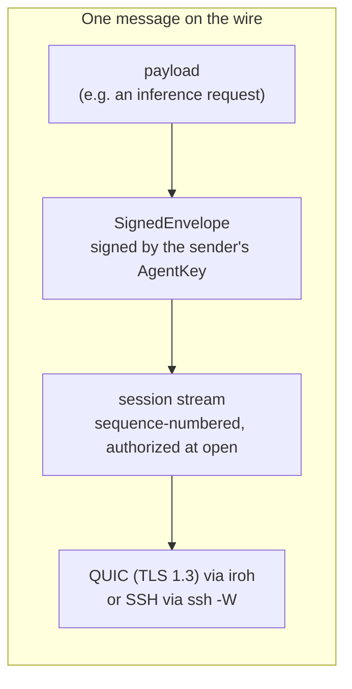
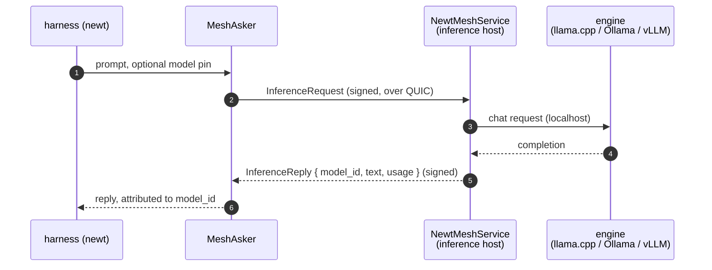
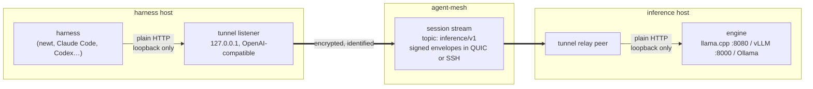
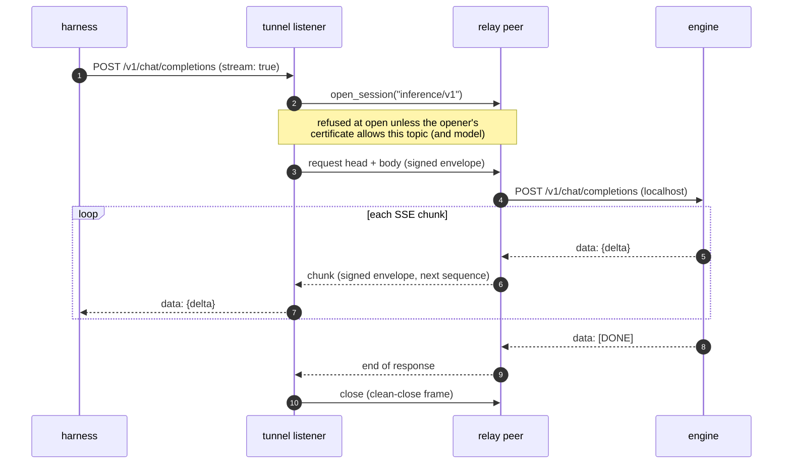
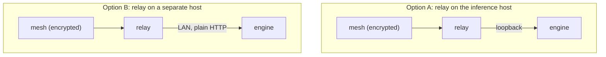

# Encrypted inference over the mesh

**Status:** research note. Today's pieces are built; the inference tunnel and
the model-scoped certificate rule are not.

**Question:** can a harness reach llama.cpp, Ollama or vLLM over agent-mesh
with its inference traffic encrypted and tied to an identity, and with the
engines left unchanged?

**Short answer:** the transport already does the encryption and the
authentication. The missing parts are a small tunnel at each end and a rule
for which keys may use which models.

## What already exists

| Piece | What it gives | Where |
|---|---|---|
| iroh QUIC transport | every connection is encrypted (QUIC carries TLS 1.3) and authenticated by cert chain at the handshake | `agent-mesh-transport` |
| Signed envelopes | every message is signed by the sender's `AgentKey`, certified by its `UserKey` | `agent-mesh-protocol` |
| Session streams | a long-lived, full-duplex conversation on one QUIC stream, authorized at open from the opener's certificate | `agent-mesh-bus` (#84), `docs/decisions/session_streams.md` |
| SSH carriage | the same bus traffic, session streams included, over system `ssh -W`, with an inner AgentKey handshake | `agent-mesh-transport-ssh` (#112), `docs/decisions/ssh_transport.md` |
| newt-mesh | single-turn inference over bus request/reply: `InferenceRequest { prompt, model }` → `InferenceReply { model_id, … }`, no streaming | newt-agent `newt-mesh` |

Each layer adds one guarantee. The transport hides the bytes from the network.
The envelope proves who wrote each message. The session refuses an opener
whose certificate does not allow the topic, and dies on a sequence gap or a
bad signature.

## Today: newt-mesh request/reply

This is encrypted and identified end to end, but it is single-turn: history is
packed into the prompt string, there are no token deltas, and a harness must
speak newt-mesh's types instead of the OpenAI-compatible API it already uses.

## Proposed: an inference tunnel on a session stream

A harness keeps its normal base URL; it just points at a local listener. The
listener carries each HTTP exchange inside a session stream to a relay peer,
which talks to the engine on localhost. The engines are untouched.

### A streamed chat completion

Full duplex means the harness can cancel mid-stream: closing the session ends
the engine request instead of leaving it to finish unseen.

## What is missing

1. **The tunnel.** A listener that maps HTTP requests (including SSE
   streaming) onto session messages, and a relay that maps them back. No new
   cryptography and no new transport: it is framing over `Bus::open_session`
   and `Bus::handle_sessions`.
2. **An inference authorization rule.** Session streams already check the
   opener's certificate against the topic. Inference also needs *which
   models* a key may use and *which inference host* the certificate is for (a
   models axis and an audience on agent-mesh certificates). Prior-art
   research on an inference gateway reached the same conclusion: no new
   crypto or proxy is needed; this rule is the real design work.
3. **Receipts (later).** Each reply already names its model (newt-mesh's
   `model_id`). A content-addressed receipt of request, model and response is
   the provenance direction, and the format stays open.

## Where the relay runs

The last hop, from relay to engine, is plain HTTP. Where the relay runs decides
whether that hop crosses a network.

- **A** keeps traffic encrypted up to the engine's loopback port, but adds a
  process to the inference host.
- **B** leaves the inference host serving models only, and the LAN hop is
  unencrypted unless the engine itself terminates TLS.

The choice is the operator's.

## Not in scope here

- Onion routing over the mesh (a phone on untrusted wifi is the use case),
  and a mesh-only path with no HTTP front at all: both experiments.
- Replacing an HTTP gateway (agentgateway, Envoy) for clients that are not on
  the mesh.
